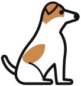

# Watchdog

**Document intelligence for journalists — drop records in, find connections.**

**[Website and documentation →](https://tomcardoso.github.io/watchdog/)**

[](https://github.com/tomcardoso/watchdog/releases/latest)
[](https://github.com/tomcardoso/watchdog/actions/workflows/ci.yml)

Watchdog is a desktop app for journalists who accumulate large sets of public records — court filings, corporate records, freedom-of-information responses, land registries and so on. You drop documents into an investigation, Watchdog reads every page, pulls out every person, company, address and relationship it finds, and builds them into a linked investigation you can search and question in plain English. Every extracted fact cites the document and page it came from.

Each investigation is a folder of ordinary Markdown files on your computer, which you can also open in [Obsidian](https://obsidian.md), a free note-taking app. The information-extraction work is done by a large language model: Claude by default, or one from OpenAI, Google, DeepSeek or another provider you choose. The questions are answered by Claude, inside the app.


## Public records only

Watchdog is careful with your files. The originals never leave your computer, and all document conversion runs locally. But the extracted text of each document is sent to a cloud AI model for analysis, and there is no way to take that back. So Watchdog is only for documents that are public, or presumptively public.

Never use it with confidential source communications, leaked or unpublished material, private correspondence, or anything that could identify a source. If you are unsure whether a document is safe to process, do not process it.

## What it does

- **Reads almost anything.** PDFs (scanned or not), Word documents, spreadsheets, images, web pages, audio and video. Scanned documents are OCR'd automatically; a 500-page PDF is no problem. Recordings are transcribed on your computer, with timestamps you can click to hear the passage.
- **Extracts entities, not just text.** People, companies, addresses, relationships and dates become linked notes, with a page-level citation on every fact.
- **Builds a timeline.** Date-bound events from every document are assembled into one chronological view of the investigation.
- **Surfaces what you might miss.** Shared addresses, overlapping directors, an entity that keeps turning up, a new document that contradicts an old one. Contradictions are flagged — they are often stories in themselves.
- **Applies specialist knowledge.** Built-in guides for 33 document types teach it what an experienced investigative journalist looks for in corporate filings, court records, land registries and more.
- **Leaves you in charge.** Every investigation is a folder of plain files you own and annotate. Facts the AI inferred rather than read are marked as such, and everything links back to the source page for verification.

## How it works

```
drop documents into the app
        ↓
Watchdog          reads, OCRs and converts each document on your computer, sends
                  the extracted text to the AI model to pull out entities, facts
                  and timeline events, then writes everything to the investigation
                  and produces a briefing — confirming before anything is sent
        ↓
your investigation  linked notes you can browse in the app or in Obsidian;
                    ask Claude questions and get answers cited to a page
```

When Watchdog has processed your documents, you read the briefing, explore the people, companies and connections, and ask questions such as "Who are the directors of Shell Co Ltd?" — with every answer cited back to a page.

## A look inside

These are from the sample investigation that comes with the app, a made-up case about a city's land deal and an untendered contract. Every person and company in it is invented.

| | |
|---|---|
|  |  |
| **Documents.** The original beside the facts taken from it, each fact tied to its page and the passage it rests on. | **Entities.** Everything the documents say about a person or company, with a cited summary and its relationships. |
|  |  |
| **Review.** Contradictions, leads and possible duplicates, with both sources cited. | **Ask Claude.** Questions answered from the documents, with a page citation for each claim. |
|  |  |
| **Timeline.** Every dated event across the investigation, linked to its page. | **Network.** How the people, companies and places connect. |

For a closer look at what happens to a single document — the OCR pipeline, the information extraction process, the final summarization step — see [this illustrated walkthrough](https://claude.ai/code/artifact/d16050d6-3357-411c-9b88-26271a330435).

## What you need

- A Mac, Windows or Linux computer, an internet connection, and about 7 GB of free disk space for the one-time setup (most of it for the libraries and models that run on your computer)
- Claude access — we recommend an Anthropic API key for reading documents (roughly US$1 per 1,000 pages with the default model) and your Claude Pro or Max subscription, if you have one, for asking questions. A subscription alone works too, but a large batch can reach its usage limit. Asking questions of your investigation always runs on Claude. The document-reading steps can be pointed at a different provider instead — OpenAI, Gemini, DeepSeek, or a model on your own computer — see [Models and cost](https://github.com/tomcardoso/watchdog/blob/main/docs/models-and-cost.md#other-providers)
- Optional: [Obsidian](https://obsidian.md), free, if you want to browse the files outside the app

You do not need a terminal, Python or Claude Code installed first; Watchdog sets up what it needs.

Watchdog benchmarks its own model and effort defaults against real court and financial filings rather than picking one on reputation alone — see [How the defaults were chosen](https://github.com/tomcardoso/watchdog/blob/main/docs/models-and-cost.md#how-the-defaults-were-chosen).

## Installation

Download the installer for your computer from the [latest release](https://github.com/tomcardoso/watchdog/releases/latest):

- **Mac, Apple silicon:** `Watchdog-<version>-arm64.dmg`
- **Mac, Intel:** `Watchdog-<version>-x64.dmg`
- **Windows:** `Watchdog-Setup-<version>.exe`
- **Linux:** `Watchdog-<version>.AppImage`

Open it and install as you would any app. The first time Watchdog opens, it walks you through setup. The [install guide](https://github.com/tomcardoso/watchdog/blob/main/docs/install.md) covers every step, including what to do if your computer warns about an app from an unidentified developer.

## Quick start

1. Open Watchdog and finish the first-run setup.
2. Choose **File → New Investigation…** (or **New investigation** on the Investigations screen), and give it a name.
3. Drag your documents onto the window, or choose **Add documents**.
4. Confirm that the documents are public records, then watch them being read.
5. Open the briefing, browse the **Documents**, **Entities**, **Timeline** and **Network** screens, and choose **Ask Claude** to ask a question.

For a full first-investigation walkthrough, see [Getting started](https://github.com/tomcardoso/watchdog/blob/main/docs/getting-started.md).

## Documentation

| Guide | What it covers |
|-------|----------------|
| [Install](https://github.com/tomcardoso/watchdog/blob/main/docs/install.md) | Downloading, installing and setting up the app; updating and uninstalling |
| [Getting started](https://github.com/tomcardoso/watchdog/blob/main/docs/getting-started.md) | The sample investigation, then your first investigation, start to finish |
| [Using Watchdog](https://github.com/tomcardoso/watchdog/blob/main/docs/using-watchdog.md) | Day-to-day work: adding documents, checking facts, Review, search, Ask Claude, your files |
| [How it works](https://github.com/tomcardoso/watchdog/blob/main/docs/how-it-works.md) | What happens to your documents, and why, in plain English; the record skills |
| [Models, cost and settings](https://github.com/tomcardoso/watchdog/blob/main/docs/models-and-cost.md) | Claude and other providers, what a run costs, how the defaults were chosen, every setting |
| [Troubleshooting](https://github.com/tomcardoso/watchdog/blob/main/docs/troubleshooting.md) | When something goes wrong |

## A note on AI and mistakes

Watchdog uses AI to read documents, and AI makes mistakes — it can misread a name or draw a wrong inference. Every fact it records links to the source document and page. Facts the model flags as inferred rather than read are marked *(inferred)* — leads to verify, not findings — but the flag is the model's own hint, and an unmarked fact can still be wrong or be its reasoning. Treat what Watchdog builds as a structured first read, not a finished product, and follow the link before you publish anything.

## Contributing

Three areas where help is most welcome:

- **Record skills** — if you know a document type deeply, the extraction guides are plain Markdown, no code required. Start from [the template](src/watchdog/skills/records/_template.md).
- **Pipeline fixes** — bug reports with a sample document (redacted if needed) are especially useful.
- **Documentation** — corrections, clarifications and translations, particularly to the install guide.

To run the app from source, see [`gui/README.md`](gui/README.md). The Python engine underneath is in `src/watchdog/`.

Please open an issue before starting significant work.

## Acknowledgements

The vault structure and session-context approach were partly inspired by [claude-obsidian](https://github.com/AgriciDaniel/claude-obsidian) by Daniel Agrici. Search is built on [fastembed](https://github.com/qdrant/fastembed) by Qdrant; the passage-window approach, `+`/`-` queries and show-the-source principle are borrowed from [Semantra](https://github.com/freedmand/semantra) by Dylan Freedman. Embedding the raw corpus separately from the knowledge graph was partly informed by [obsidian-smart-connections](https://github.com/brianpetro/obsidian-smart-connections) by Brian Petro, and the structured vault index for entity lookup by [obsidian-claude-code](https://github.com/Roasbeef/obsidian-claude-code).

## License

MIT — see [LICENSE](LICENSE).
