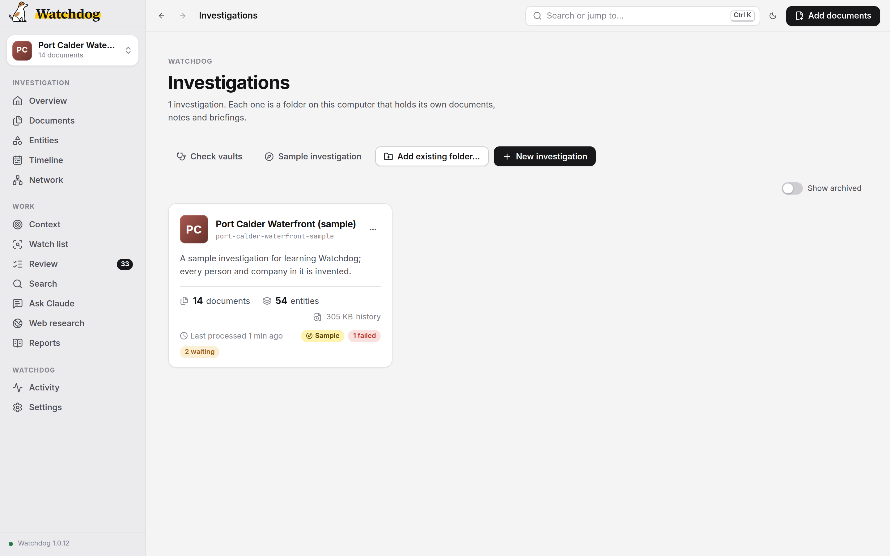
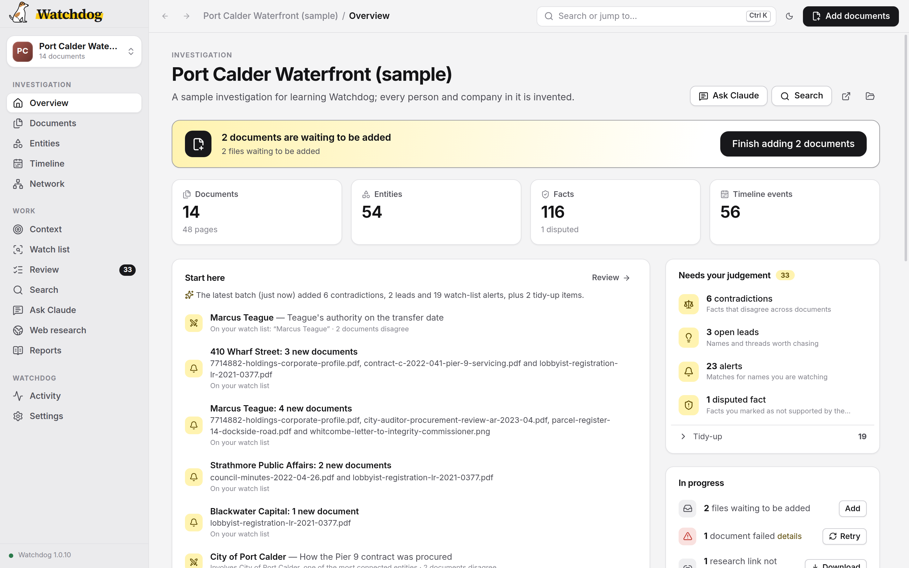

# Getting started

This walkthrough takes you through your first investigation from start to finish: creating an investigation, adding documents, watching them being read, reading the briefing, and asking Claude questions. It assumes Watchdog is already installed and set up; if not, start with the [installation guide](install.md).

Two things to keep in mind before you begin.

> **Public records only.** Your original files never leave your computer — all the file conversion and OCR happens locally. But the extracted text of each document (a plain-text representation of its contents) is sent to a cloud AI model for analysis. That is why Watchdog must only be used on documents that are public or presumptively public. Never process confidential source material, leaked documents, private correspondence, or anything that could identify a source. If in doubt, do not process it.

> **Verify before you publish.** AI extraction makes mistakes. Every fact Watchdog extracts links back to its source document and page, and facts the model inferred rather than read are marked as inferred — those are leads, not findings. Follow the link to the page before you publish anything.

## Try the sample investigation

If you would like to see what a finished investigation looks like before adding your own records, start with the sample. **Port Calder Waterfront (sample)** is a made-up case about a city's land purchase and a contract awarded without a tender. Every person, company and document in it is invented.

To open it, choose **Get started** or **Explore a sample investigation** at the end of setup, **Sample investigation** on the Investigations screen, or **Help → Take the Tour**. The first time, Watchdog builds it on your computer, which takes under a minute. It uses prepared answers instead of an AI model, so it costs nothing and needs no sign-in, key or internet connection. Its runs show $0 under **Activity → Usage**.

The tour then opens one screen at a time and points at a real finding: the briefing, a scanned page you can search, an entity's facts and their sources, a fact you can mark as checked, a contradiction, a near-duplicate, a lead, Search, the timeline and network, what a run costs, adding documents and Ask Claude. Use **Next** and **Back** to move through it, or **Skip tour** to close it. It remembers where you stopped, and **Help → Take the Tour** starts it again from the beginning.

Two files are left waiting in the sample's incoming folder, a change order and the notes of a site meeting. When the tour reaches **Adding documents**, choose **Read documents** to add them and watch a run from start to finish: Watchdog reads the files on your computer, extracts their facts and writes a new briefing, which points to a new contradiction. Prepared answers stand in for the AI model here too, so the run costs nothing, sends nothing anywhere and does not ask you to confirm that the files are public records.

The sample only processes its own example files. If you add a document of your own to it, Watchdog stops before anything is sent and says so; create your own investigation for your documents. **Re-check contradictions** works in the sample with prepared answers.

**Ask Claude** never reaches Claude in the sample. Instead it offers four questions with conversations prepared in advance, so you can see what a session does without spending anything on a made-up case. Choose one and the conversation plays as if live: Claude searches the documents and reads the notes (each step appears as a row you can open), then answers with a citation for each claim. Choose a citation to open the document at the fact it cites. One question asks Claude to add a name to the watch list, so you can see the card Claude shows before it changes anything; choose **Allow once** and the name really is added to the sample's watch list. A label says the conversations are prepared, and you cannot type your own question there. In your own investigations, Ask Claude answers any question, using your Claude account; see [Ask Claude](using-watchdog.md#ask-claude).

You can change anything in the sample. To start it afresh, choose **Rebuild the sample…** from its **⋯** menu on the Investigations screen; that replaces only the sample. Delete it like any other investigation when you no longer need it.

## Create an investigation

Each investigation lives in its own folder on your computer: your documents, plus a linked set of notes Watchdog writes about them. To create your first, choose **Cancel** on the sample prompt that follows setup, then **New investigation** on the Investigations screen. Later, use **File → New Investigation…**, or open the investigation menu at the top of the sidebar and choose **New investigation…**.

The dialog asks for three things:

- **Name.** Use one that will still make sense in six months.
- **One-line description.** Optional, and you can change it later from the Overview. It is the first thing Watchdog knows about your investigation, which is useful when you have several open at once.
- **Where to keep it.** The default is the investigations folder you chose in setup. If you pick a different folder, Watchdog asks permission to work there; see [Folder access](using-watchdog.md#folder-access).

Choose **Create investigation**. Watchdog makes a folder named after the investigation (for example `shell-company-investigation`) and sets up its structure, including the `incoming/` and `context/` folders, the starting notes (`log.md`, `context.md`, `index.md`), and the settings for Claude. [Your files and Obsidian](using-watchdog.md#your-files-and-obsidian) explains what is in it.

The investigation opens on its **Overview**. It is empty until you add documents.

## Seed your context (optional but recommended)

Before adding records, it helps to tell Watchdog what you are investigating. This is especially useful for large or long-running investigations.

Put any background material in the investigation's `context/` folder: prior published stories, notes, screenshots of relevant web pages, anything that describes the scope. The fastest way to open the folder is **File → Show in Folder**. Then open **Ask Claude** and choose **Seed investigation context**.

Claude reads the material and interviews you — who the key people and companies are, what you are looking for, what documents you expect. It then writes `context.md`, an investigative brief that persists across every future conversation and tells Claude what you already know.

Two things to keep in mind about the brief. First, it is sent to the AI model with every document you add, and used for the briefing, so it leaves your computer just as the documents do: keep source names, contact details, unpublished tips and anything confidential out of it, and out of the `context/` folder. Second, write it as open questions rather than conclusions: "I want to understand how the Pier 9 contract was awarded" or "I want to explore who owns the numbered company", not "the councillor hid her conflict". The model reads every document with the brief in view, and a brief that states what you expect to find can lead it to read the documents that way. Claude drafts the brief in this style; you can edit it at any time under **Briefings**. It also proposes a short list of watch-list candidates (names, companies and addresses drawn from the same material) for you to accept, edit or skip. Anything you approve is added to the watch list right away.

This step is optional, but it noticeably improves the quality of summaries and of connection-finding. Once the brief exists, the Overview also shows a prompt to read any background folder not yet read.

## Add documents

You can add documents three ways:

- **Drag them onto the window.** Drop files or whole folders anywhere in the app, and Watchdog adds them to the open investigation.
- **Choose Add documents.** The button is at the top right, and also under **File → Add Documents…**. On an empty investigation, the Overview shows **Choose files…** and **Choose a folder…** buttons that do the same.
- **Put files in the `incoming/` folder** inside the investigation, using your file manager. Watchdog lists anything waiting there on the Overview and in the Add documents dialog.

Watchdog handles PDFs (scanned or not), Word documents, spreadsheets, presentations, images, web pages, plain text, and audio and video recordings, which it transcribes on your computer; see [Supported file types](using-watchdog.md#supported-file-types) for the full list.

**Rename files before adding them.** Watchdog uses the filename when labelling documents. `shell-co-annual-report-2023.pdf` is useful; `scan0042.pdf` is not.

**Add a sidecar file for provenance.** To record where a document came from, put a small `.yml` file with the same base name next to it, as in `shell-co-annual-report-2023.pdf` and `shell-co-annual-report-2023.yml`. It can contain a `source`, the date `obtained`, and `notes`; see [Sidecar files](using-watchdog.md#sidecar-files).

**Duplicates are handled automatically.** A document that is byte-identical to one already added, even under a new name, is set aside in `incoming/skipped/` rather than processed twice. A separate check flags similar-but-not-identical files (a redlined revision, say) for your review, but never skips them.

## Confirm and watch the run

The Add documents dialog takes you through four steps.

1. **Choose.** Pick files or folders. The dialog also shows anything already waiting. **Estimate cost** shows what the run is likely to cost before you commit, and **Options** lets you change the models and other settings for this run only. The defaults are fine for a first run.
2. **Reading documents.** Watchdog copies the files into `incoming/` (your originals stay where they are) and converts them to text on your computer, using OCR for scans and transcribing recordings. The first recording you add also downloads the transcription model, once. Nothing is sent anywhere during this step.
3. **Before anything is sent.** This is the public-records confirmation. It shows the exact number of documents about to be sent and which model will receive them. Nothing goes until you choose **Acknowledge and add**. If you set Watchdog to skip this pause for runs that use only your Claude subscription, you see a short notice instead; see [Auto-approve](models-and-cost.md#auto-approve). If every step runs on a model server on this computer, there is nothing to confirm and this step is skipped; see [Local and self-hosted models](models-and-cost.md#local-and-self-hosted-models).
4. **Adding.** Watchdog extracts entities, facts and timeline events from each document, writes everything to the investigation, and produces a **briefing**.

Large documents can take several minutes each to extract, so a long pause on one document is normal. On a Claude subscription, a large first batch can reach your plan's usage limit, which stops the run; nothing finished is lost, and [Hitting rate limits](troubleshooting.md#hitting-rate-limits) explains what to do. You can choose **Hide** to close the dialog; the run continues, and its progress stays visible in the corner of the window. **Stop** ends the run cleanly, and adding the documents again picks up where it left off. **Activity** lists every run with its full output.

By default every step runs on Claude Haiku, Claude's fast, inexpensive model, so nothing beyond the Anthropic key or Claude sign-in you set up is needed. [Models and cost](models-and-cost.md) covers choosing other models and providers, and what a run costs. [How it works](how-it-works.md) explains what each stage does to your documents, and what the AI model does and does not see.

## Read the briefing

When the run finishes, the **Overview** shows the headline from the latest briefing, with a button to read the whole thing. The briefing summarizes what was found, how it connects to entities already in the investigation, and anything worth following up. Read it carefully: the connections section is often where the story is.

The Overview also shows what is waiting on you (contradictions, leads, possible duplicates, possible same entities and watch-list alerts) and what is in progress, with each item linking to the screen that deals with it. Every briefing Watchdog writes is kept under **Briefings**.

## Explore the results

The sidebar lists the screens for the open investigation.

- **Documents** shows every document as a thumbnail or a list. Open one to read the original beside the facts taken from it; each fact's page number scrolls the original to that page.
- **Entities** lists every person, organization, place and so on, with the number of documents each appears in. An entity's page shows its summary, its relationships and the documents it appears in.
- **Timeline** lays out every dated event, with links to the page each came from.
- **Network** draws entities and their relationships as a graph. Entities that appear in many documents, or connect to many others, stand out.
- **Search** finds exact words, passages ranked by meaning, and notes. Press Ctrl+K (⌘K on a Mac) anywhere to jump to something by name.

If the same person or company shows up twice under different names, see [Duplicate entities](using-watchdog.md#duplicate-entities). [Using Watchdog](using-watchdog.md) explains every screen.

## Review what needs a decision

Choose **Review** to work through contradictions, leads, watch-list alerts, possible duplicates, possible same entities and document requests, one tab each. A count beside Review in the sidebar shows how many items are waiting. Mark an item handled and it stops appearing in briefings and on the Overview. Leads (names and threads worth chasing) and watch-list alerts are refreshed after every run.

## Ask Claude

Choose **Ask Claude** and type a question, such as "Who are the directors of Shell Co Ltd?". Claude answers using only the documents in your investigation, and cites the source for every claim. You can follow up ("what else has she signed?") in the same conversation. Past conversations are listed on the left, and you can start a new one with **New conversation**.

Start a new conversation for a new line of inquiry rather than reusing one that has run long. At the start of each conversation, Claude is given a short account of where the whole investigation stands, which Watchdog builds from its records, so it knows the state of things without re-reading everything, and a fresh conversation has the most working room for your questions.

Before Claude changes the investigation's records, Watchdog shows what it is about to do and asks you first; see [Ask Claude](using-watchdog.md#ask-claude).

## Where next

[Using Watchdog](using-watchdog.md) covers everything you do from here: checking facts, working through Review, searching, asking questions, researching on the web, and managing investigations. [Troubleshooting](troubleshooting.md) covers what to do if a run does not go as expected.
