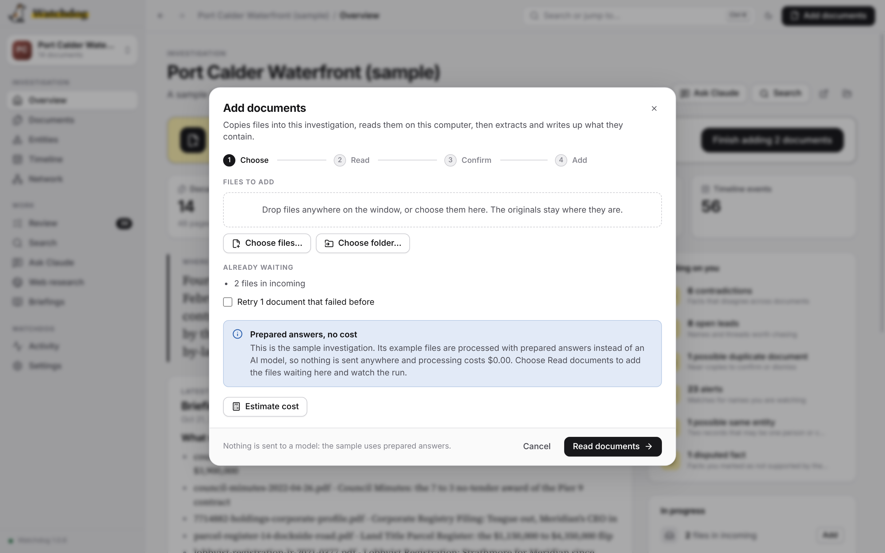
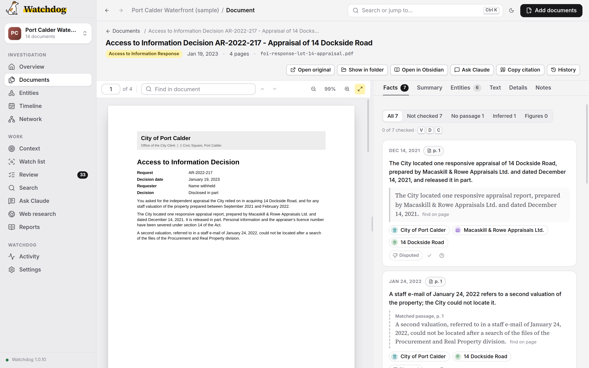
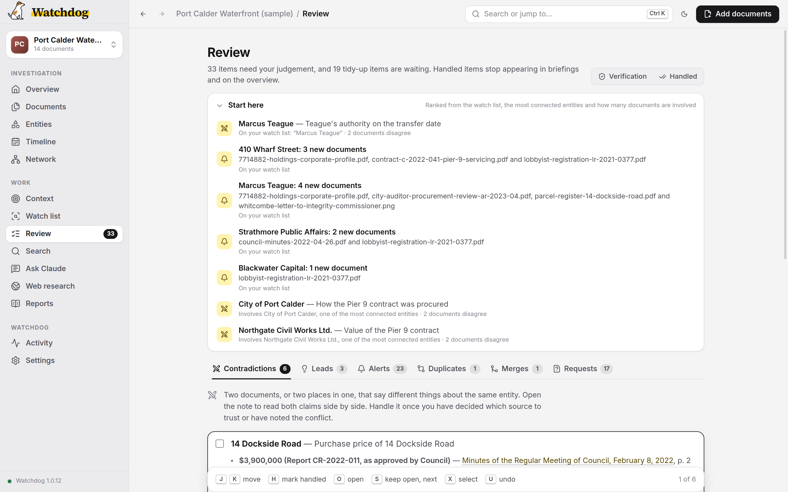
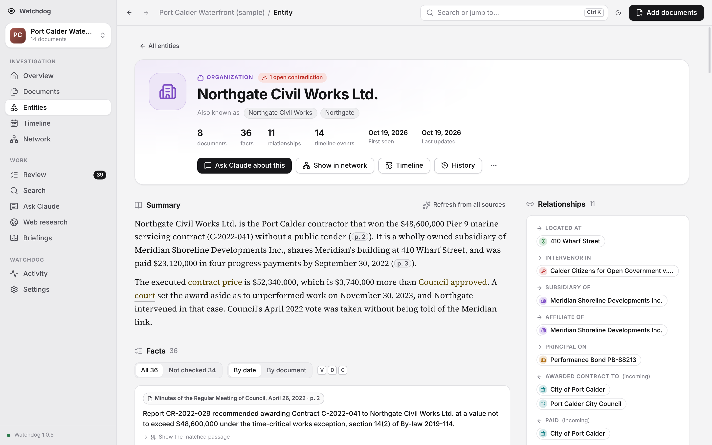
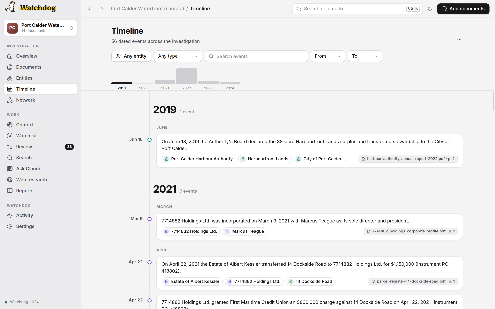
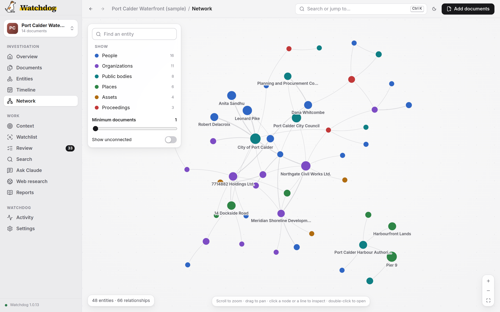
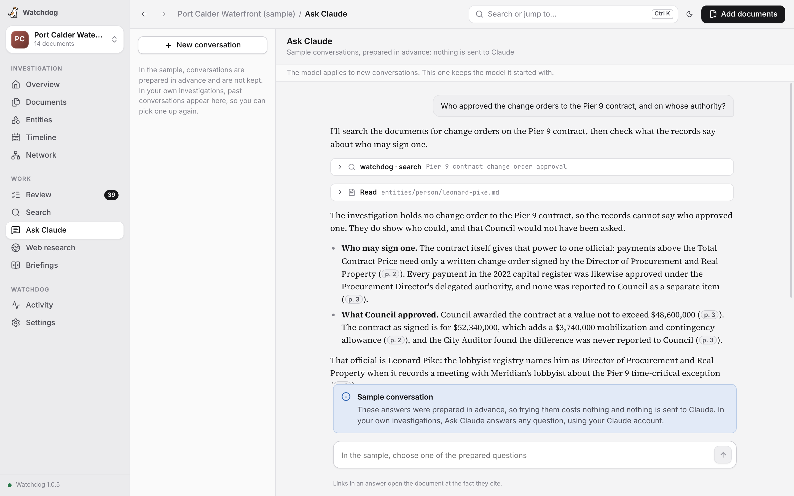
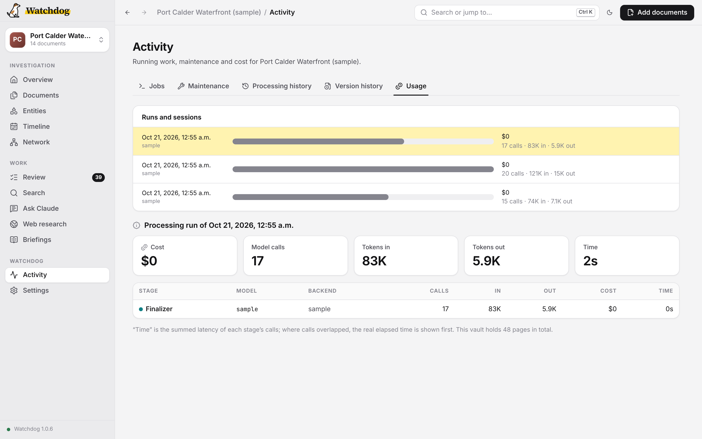

# Using Watchdog

This page covers the day-to-day work of an investigation, task by task: adding documents, checking what Watchdog found, working through what it flagged, asking questions and keeping your investigations in order. Read [Getting started](getting-started.md) first if you have not added your first documents yet.

> **Public records only.** The app sends the text of your documents to the AI model you chose. Before it sends anything, it shows a warning with the number of documents and where they go: the provider (Anthropic, OpenAI, DeepSeek, Google or OpenRouter) or, for a [self-hosted model](models-and-cost.md#local-and-self-hosted-models), its server's address. Use Watchdog only for documents that are public or presumptively public.

## Finding your way around

The sidebar groups the screens. **Overview**, **Documents**, **Entities**, **Timeline** and **Network** are under Investigation; **Context**, **Watch list**, **Review**, **Search**, **Ask Claude**, **Web research** and **Briefings** under Work; **Activity** and **Settings** below them. The investigation's name sits at the top: click it to switch to another investigation, see all of them, or create one. The app's version is at the bottom.

Press **⌘K** (Ctrl+K on Windows and Linux) anywhere to jump to an entity, a document or a screen by typing part of its name, or to start a search or a question. **View** has a shortcut for each Investigation screen, from Overview to Network (⌘1 to ⌘5, or Ctrl+1 to Ctrl+5), and **Ctrl+Tab** and **Ctrl+Shift+Tab** move to the next or previous item in the sidebar, in order, on every computer. **⌘[** and **⌘]** (Ctrl+[ and Ctrl+] on Windows and Linux) go back and forward through the screens you have visited; on Windows and Linux, Alt+← and Alt+→ do too, except while you are typing. **Help → Take the Tour** walks through the app one screen at a time, using the [sample investigation](getting-started.md#try-the-sample-investigation).

The **Overview** is the investigation's front page. It opens with **Start here**, a short list of the items in Review most worth your time (see [Start here](#start-here)), and one line on what is new. Until you first open Review, it says what the latest batch added, such as "The latest batch added 6 contradictions and 4 leads." After that, it says what has come in since you last opened Review and is still open; when nothing has, there is no line. Below are the headline from the latest briefing and the briefing itself. At the side, **Needs your judgement** counts the contradictions, leads, watch-list alerts and disputed facts waiting for you; the number beside the heading counts these only. **Tidy-up**, folded to one line under it, totals the possible duplicate documents, possible same entities and document requests, which you can work through in bulk; click it to see all three. **In progress** lists what is still being added. Each item links to the screen that deals with it.

Watchdog remembers when you last opened Review in each investigation. In Review, each item a batch added since then is labelled **New**.

A typical loop, once the first batch is in: add documents, read the briefing, work through Review, then ask questions. After a substantial batch, **Find connections** in Ask Claude looks for connections you did not think to ask about.

## Adding documents

Drop files or folders onto the window, choose **Add documents** (top right, or **File → Add Documents…**), or put files in the investigation's `incoming/` folder with your file manager. The dialog takes you through four steps:



1. **Choose.** Pick files or folders. The dialog also shows anything already waiting in `incoming/`, and offers to retry documents that failed before. **Options** holds every setting for this run only: models, effort, **Documents at once**, **Record skill**, **Second-read check**, **Wait out rate limits** and the rest. **Estimate cost** shows what the run is likely to cost, and **Compare all models** shows the estimate for each model.
2. **Reading documents.** The files are copied into `incoming/` (the originals stay where they are) and converted to text on your computer, with OCR (optical character recognition) for scanned pages. Recordings are transcribed here, one at a time; the first one also downloads the transcription model, once. Nothing is sent anywhere during this step.
3. **Before sending documents to a model.** Files that could not be read are listed first, and a file the investigation already has is set aside in `incoming/skipped/`. Then the public-records warning, with the number of documents, which model receives them and, if you keep more than one key, which key pays. Nothing is sent until you choose **Acknowledge and add**. With [Auto-approve](models-and-cost.md#auto-approve) on and every step on your Claude subscription, this step is a short notice instead; when every step runs on a model server on this computer, it is skipped.
4. **Adding.** Each document is extracted, then the finishing steps write everything to the investigation and produce a briefing. **Hide** closes the dialog while the run continues, with its progress in the corner of the window. **Stop** ends it cleanly, and adding again resumes it.

The run stays with the investigation you started it in. If another investigation is open when the pause or the finished run appears, the window says so, with **Switch to** that investigation.

**Rename files before adding them.** Watchdog labels documents by their filename: `shell-co-annual-report-2023.pdf` is useful; `scan0042.pdf` is not.

**Duplicates are handled automatically.** A file byte-identical to one already added, under any name, is set aside rather than processed twice. Similar but not identical files, such as a redlined revision, are flagged on the Duplicates tab in Review, never skipped.

**Right after installing or updating,** adding documents waits until setup has finished downloading in the background. The buttons say why, and the **Finishing setup…** bar at the bottom of the sidebar shows how far along it is.

**File → Fetch Links…** downloads web pages from a list of addresses into `incoming/`, from where you add them like any other document.

### Supported file types

| Format | Extensions | Notes |
|--------|-----------|-------|
| PDF | `.pdf` | Text-based, scanned, or a mix; OCR applied page by page wherever the text layer is missing or garbled |
| Word | `.docx` | Tables and formatting preserved |
| Excel | `.xlsx` | |
| PowerPoint | `.pptx` | |
| Image | `.jpg`, `.jpeg`, `.png`, `.tiff`, `.tif`, `.bmp`, `.webp` | OCR applied automatically |
| Web page | `.html`, `.htm` | |
| Plain text | `.txt`, `.csv`, `.md` | |
| Audio | `.mp3`, `.m4a`, `.wav`, `.aac`, `.ogg`, `.oga`, `.opus`, `.flac` | Transcribed on your computer |
| Video | `.mp4`, `.m4v`, `.mov`, `.webm`, `.mkv`, `.avi` | The sound track is transcribed; a video with no sound cannot be added |

### Recordings

A recording is transcribed on your computer by a speech-recognition model, before anything else happens to it. A transcript's "pages" are blocks of five minutes, so a fact from a recording cites a time range such as 10:00–15:00 rather than a page; click it to play that passage. Each passage starts with the time it was spoken.

A machine transcript is a draft, not a record. It has no speaker names, so it cannot tell you who said what unless the speech itself does ("Councillor Ferreira, you have the floor"). It mishears names first, then figures and technical terms. Watchdog tells the model it is reading a transcript and to flag names and figures that look wrong, but before you quote anyone, click the timestamp and listen. The model used is set under [Transcription](models-and-cost.md#transcription).

### Sidecar files

To record where a document came from, put a small `.yml` file with the same base name next to it, as in `shell-co-annual-report-2023.pdf` and `shell-co-annual-report-2023.yml`:

```yaml
source: https://www.sedar.com/filing/xyz
obtained: 2026-06-05
notes: Check the director change on page 12.
skill: corporate-filings
```

`source`, `obtained` and `notes` are kept with the document. `skill` pins that one document's [record skill](how-it-works.md#record-skills) and skips classification for it, so a batch of mixed document types can be pinned one by one; it must name a skill from **Settings → Record skills**. Any other field is dropped. The sidecar is read once, when the document is read, so edit it before adding the document. Files saved by **Fetch Links** and Web research arrive with a sidecar already attached.

## Reading a document

**Documents** shows every document as a grid of first-page thumbnails or a sortable list. A strip above it shows files not yet in the investigation (waiting, failed or set aside), with **Retry** (put failed documents back and run them again) and **Requeue** (put them back without running them).



Open a document to read it: the original on the left, with page navigation and zoom, and the facts taken from it on the right. Each fact's page number scrolls the original to that page. Other tabs show the summary, the entities it names, its full extracted text, its details (including metadata embedded in the file, such as author and creation date, which is a lead, not a fact) and [your notes](#history-and-your-notes).

<a id="finding-words-in-a-document"></a>**Find in document** sits above the original in every kind of viewer; press ⌘F (Ctrl+F) to jump to it. It ignores capitals, accents, the style of quotation marks, dashes and line-break hyphens, so "Renee" finds "Renée". On a scanned page, find highlights the match on the scan itself, and you can select and copy its text; the highlight's position within a line is an estimate. When find turns up nothing, **Search the extracted text instead** opens the Text tab.

A recording opens in a player with its transcript below; the passage being spoken is highlighted as it plays. Some formats (`.avi` and some `.mkv` files) cannot be played inside Watchdog; **Open original** plays them in another app.

## Checking facts

Every fact Watchdog extracts is a claim to check, not a finding. The app gives you what you need to check it, and a place to record that you did.

### Source passages

Under each fact is the text from the document that supports it:

- **A quotation**, when the model quoted the source and Watchdog confirmed the wording is there.
- **A matched passage**, labelled with its page. Watchdog found it by comparing the fact's names, figures and dates with the sentences on the cited page, using ordinary code, no AI (see [How a passage is found](how-it-works.md#how-a-passage-is-found)). It is the sentence most likely to be the source, not proof that it supports the claim.
- **"No matching passage found"**, when nothing on the cited page shares enough with the fact. It may combine several passages, rest on reasoning, or cite the wrong page. Read the page yourself.

**find on page** beside a passage scrolls the original to it.

### Stated and inferred

The model marks a fact *(inferred)* when it reasoned to it rather than read it in the document. Treat an inferred fact as a lead to verify. But the mark is the model's own hint, not a check: it marks very few facts this way, and an unmarked fact is not thereby guaranteed to be stated in the document.

On an entity's page, a fact that says **link inferred** reached the entity through a model's judgement: the document named the entity by a label it did not define, such as an abbreviation, and a model matched the label to this entity (see [matching labels to entities](how-it-works.md#fact-tags)). The fact itself is as the document states it; check the page to confirm it is about this entity.

Watchdog also checks every number in a fact against the page it cites, and the pages either side, allowing for figures printed in thousands or rounded. Where a number does not check out, the fact carries a note: *figure not found in the document — may be derived* (usually a total or difference the model calculated; check the arithmetic), or *found on another page, not the one cited*. Roughly two to three per cent of facts carry one, so a note is worth stopping on. Dates are not checked this way.

### Marking facts

Watchdog uses every fact as extracted until you say otherwise, so you never have to work through them one by one. When a fact is wrong, click **Disputed**, the thumbs-down beside it: the source, or another record, does not support it. Two smaller buttons beside it, **Verified** (you read the source and the fact holds) and **Can't verify**, are there if you want a record of what you checked, for instance before publication. Click a mark again to clear it. Watchdog records your name and the time; set the name under [Your name](models-and-cost.md#verification). Once a fact is marked, **Add note** records what you checked it against. Marking never changes the fact and never calls an AI model.

The bar above the facts filters them (all, not checked, no passage, inferred, figures). Select a fact, then use the keyboard: J and K move, D disputes it, V or C marks it, N edits the note.

A fact you mark Disputed is never hidden. Wherever it appears (the document, the entity, the timeline, Review, citations, the notes on disk and what Claude is told) it carries the label **disputed**, and the summaries are told not to present it as established.

**Review → Verification** lists the investigation's facts with the same buttons. It opens on the facts you disputed, then on **Worth checking**: facts you have not marked that the model inferred, that carry a figure not found in the document, or that have no matching passage on their page. Other filters show can't verify, verified, all facts, and **changed since marked**, for facts whose wording or page changed after a document was processed again. Your mark stays with the old wording, since you did not check the new words. Every change rewrites `verification.md` in the investigation's folder, the written record of your checks.

## Review

**Review** is where everything Watchdog flagged waits for you, one tab each. The number beside Review in the sidebar counts the items that need your judgement, as on the Overview; the page's own line also counts the tidy-up. Read an item, open it if you need more, then mark it handled or keep it open. **Mark handled** removes an item from the queue, the Overview and future briefings, without deleting it; **Handled**, at the top right, lists what you have handled, and **Bring back** returns one. The keyboard works throughout: J and K move, H marks handled, O opens, S keeps open and moves on, X selects, U undoes.

**Duplicates**, **Merges** and **Requests** are tidy-up, so they are tables rather than cards: one row each, with a tick box. Tick rows with the mouse or X, or tick every row from the box in the heading, then choose what to do with all of them from the bar at the bottom. The row you are on opens underneath with the full detail. On these tabs, H gives the row's everyday answer (not the same, these are copies, or handled) to the ticked rows, or to the row you are on when none is ticked.



### Start here

Above the tabs, **Start here** lists up to seven items to look at first, each with one line on why it is there; the Overview shows the same list. The order comes from ordinary code (no AI), from what the investigation already records:

1. An item tied to a term on your [watch list](#watch-list): the alerts, and a contradiction or lead about an entity whose name matches a term. A term's alerts are one item, such as "Harbourline Dredging: 3 new documents", with the documents named; click it to see that term's alerts on the Alerts tab.
2. An item about one of the most connected entities (those with relationships to the most others, as in the Network) or about an entity that several documents are mainly about.
3. A contradiction between two documents, ahead of one between two passages of the same document.
4. A lead named in several documents, ahead of one named in only one.

Ties go to the item involving the better-connected entity, then the one in more documents. No kind of item fills more than half the list while others are waiting. The counts elsewhere still count each document a term was found in, since each is a document to read. Tidy-up items never appear here, and nor does anything about an entity you [removed](#removing-an-entity). Click an item to go to it on its tab. In Review, click **Start here** to fold the list away; Watchdog remembers the choice.

### Contradictions

When a document disagrees with something already in the investigation, the item appears here with both claims and their sources, and on the entity's page. Two official records that disagree can be the story. **Ask Claude** on an item opens a conversation pointed at it. If you spot a conflict Watchdog missed, choose **Record a contradiction…** from the entity's **⋯** menu.

<a id="re-checking-contradictions"></a>Each run compares new facts with the facts already recorded, not old facts with each other. **Re-check** beside an entity's Contradictions heading compares every recorded fact about the entity with every other, after showing how many model calls it takes and what it should cost; **Activity → Maintenance → Re-check contradictions** does it for every entity. An entity needing more than 45 calls cannot be re-checked, and its button says so. What a re-check finds is filed like any other contradiction, without repeating one already recorded or handled.

### Leads

At the end of every run, ordinary code (no AI) sweeps the entities and lists four kinds of lead:

- an entity named as a relationship target that has no documents of its own: a company someone directs, say, that you have no records on;
- an entity that turns up in several documents but has no relationships;
- an unresolved contradiction;
- a relationship the model inferred rather than read.

Inferred facts and figures not found in their document are listed under **Review → Verification → Worth checking**, beside their page, rather than here.

A relationship-target lead shows who names the target, how, on which page, and links to each document under **Named in**. The AI model sometimes points a relationship at something it never wrote down as an entity, leaving only a short label (an id) instead of a name. Before anything is saved, Watchdog tries to match that label to an entity it already has (see [matching relationship targets](how-it-works.md#relationship-targets)); a label it cannot match stays a lead that says so, and the document is the only way to tell who or what it means. A relationship whose target the AI model matched says **inferred** beside the target on the entity's page and **target inferred** on the Network; hover over it to see the label the document gave.

**Copy leads** copies the open leads, or the ones you have selected, as a table to paste into an email or a spreadsheet. **Run full lead sweep** refreshes the list.

### Duplicates

Documents judged to be near-copies of one already in the investigation, one row each, with the document it closely matches; the row you are on shows both side by side. Tick the pairs you have checked, then choose **These are copies** (H) if they are the same record, or **Different documents** (D) if the difference matters. Neither deletes anything. A copy stays marked as a copy in Documents and on its page; for different documents, the possible-duplicate flag goes from both. Either answer can be reversed under **Handled** with **Bring back**.

### Merges

Two documents often name the same person or company, and Watchdog has to decide whether they mean the same one. It never decides on a name alone (see [how Watchdog decides two names are the same](how-it-works.md#same-entity)). Pairs it was unsure about wait at the top of this tab as **possible same entities**, one row each: both names, how many documents each is in, the strongest evidence they share (the same registration number, say, or the same relationship to the same company) and how confident Watchdog was. The row you are on shows the two records side by side with their facts.

Tick the pairs that are one and choose **Merge ticked** (M); Watchdog asks first, listing which record each pair keeps: the one named in more documents, or else the longer name. The pairs are merged one at a time, and each merge goes into **Recent merges**, where it can be undone on its own. If one pair cannot be merged, the others still are, and the tab says which failed and why. Tick the pairs that are not one and choose **Not the same for ticked** (H); Watchdog never merges those two automatically. To choose which record to keep, use **Merge…** on the open row instead.

When many records share one name, the queue does not list every possible pair. A short name that cannot be told apart, such as "Mr. Pike" in five documents, is shown as four pairs, each record beside the one named in the most documents. For a name the AI model compared, only the records it could not tell apart are listed.

Below the queue, **Recent merges** lists every merge, newest first: which records, how confident the decision was, and who decided (Watchdog's rules, the AI model by name, or you). If a merge is wrong, open it and choose **Undo merge**; Watchdog gives the merged record back its own facts, documents and relationships, and marks the pair Not the same. Contradictions recorded while the two were joined, your notes and the summary stay with the surviving entity. Where a merge cannot be split exactly, the button says why. The same record is kept in `merges.md`.

### Requests

Documents your documents refer to but you do not have: the transcript a hearing order cites, an exhibit filed but never attached. Each carries why it matters, where it can plausibly be obtained, and links to the documents that named it.

The table lists the requests most cited first. **By likely source**, the default, groups them by the office or company the AI model said holds them, so one request letter can cover a group; **Most cited first** shows one list. The grouping goes by the name at the start of the likely source and ignores what follows a comma, a bracket or words such as "or" and "by", so "City Clerk" and "the City Clerk, by access request" fall together. Two names for one place, such as a registry's official name and a description of it, are grouped by a model when a run adds a source it has not seen (see [grouping request sources](how-it-works.md#request-sources)); such a group says **grouped by AI**, hovering over it shows the names it joined, and **Show apart** undoes a grouping you disagree with for good. Each request keeps its own wording. Tick a group's heading to tick all its requests. **Copy requests** copies them, or the ticked ones, as a table to paste into an email or a spreadsheet. For a document held by a public body, [Ask Claude](#ask-claude)'s **Draft a records request** drafts the request letter: a freedom-of-information, access-to-information or public-records request. Mark requests handled (H) once you have filed them or decided not to. When a run adds a request, a model merges any open requests it judges to name the same document; if one seems missing, check whether it was merged into a differently worded one.

## Entities

**Entities** lists every person, organization, public body, place, asset and proceeding, with the number of documents each appears in. Search by name or alias, sort, and filter by type, by contradictions or to **Single-source** entities, named in only one document, which is where a duplicate usually shows up.



An entity's page shows everything the documents say about it:

- **Facts** from every document, in the order things happened (or by document), each with its page, any warning and the same marking buttons and keys as the document reader.
- **Summary**, written by an AI model from the facts once the entity appears in two or more documents. A sentence that rests on a fact ends in a citation such as **p. 4** (see [Citations](#citations)). Treat it as a reading aid, and the facts as the record.
- **Contradictions**, **Timeline**, **Relationships**, the documents it appears in, and [your notes](#history-and-your-notes).

### Duplicate entities

Sometimes one person or company ends up as two entities, usually because a name is spelled differently. Select the two on the Entities screen and choose **Merge…**, or open one and choose **Merge into another entity…** from its **⋯** menu. The dialog shows both before you commit. Everything combines onto the survivor, and the merge is recorded under your name; it can be undone from [Merges](#merges). Afterwards, **Rebuild search index** removes the merged entity from Search, and **Refresh summary from all sources** rewrites the survivor's summary.

### Removing an entity

Processing profiles everything the documents name, including things that are not part of your story: an office on a letterhead, a research centre that helped you, your own newsroom. To take one out, choose **Remove from investigation…** from its **⋯** menu, from a selected dot's card in the [Network](#timeline-and-network), or select one or more on the Entities screen. The dialog says what will happen before anything changes.

A removed entity is left out of the Network (with every line to it), the Entities list, entity notes in Search, Review and the counts on the Overview. Documents added later that name it do not bring it back, and neither does Watchdog deciding that a new record is the same thing.

Nothing is deleted. The documents still say what they say: the entity's facts stay in each document's note and in source passages in Search, and other entities keep their relationships to it in their own notes. The AI model also still reads those facts when it writes summaries and briefings and looks for contradictions, so removing an entity does not change what a summary is based on. An export of the investigation's entities still includes it.

Removed entities are listed under **Removed** at the bottom of the Entities screen's type list, with who removed each and when. **Bring back** shows one again; it is also on the entity's own page, which still opens. If a removed entity is merged with another, the survivor keeps its own state: it is hidden only if it was removed itself. Undoing that merge removes the split record again.

## Timeline and Network

**Timeline** lays out every dated event by year and month, each linked to its page. Filter it by entity, type, years or a word. An event whose fact you disputed stays, labelled **disputed**.

An event dated only to a month or a year says **month only** or **year only**. One that covers a period is shown as a range, such as "Apr–Jun 2024", under the month it starts, and says **range**. When a model, not the document's own wording, settled a date (a period, a quarter, a date in words or one written in figures that could be read two ways), the event says **date inferred**; hover over it to see the date as printed, and check the page before you rely on it. [How it works](how-it-works.md#dates) explains how dates are read.



**Network** draws the entities as a graph: each dot an entity, sized by how many documents name it and coloured by type, with one line between two related entities. Hover over a dot to see its connections, click for details, double-click to open it. Click a line for every relationship between the two, with the documents and pages that state it. When documents describe one relationship in different words ("lawyer for", "counsel for"), it is listed once with each document's own words shown as "As written" (see [how wordings are grouped](how-it-works.md#relationship-wordings)); **Show wordings separately** undoes a grouping you disagree with. A slider sets the minimum number of documents for an entity to be drawn. To take something that is not part of your story out of the graph for good, use **Remove from investigation…** on its card (see [Removing an entity](#removing-an-entity)).



## Search

**Search** covers the whole investigation without involving Claude, in three sections: **exact matches** of your words, **source passages** ranked by how close they are in meaning, and **notes** (what the investigation has concluded). Searching for "conflict of interest" finds passages about recusals even when the phrase never appears, while a case number or a dollar figure still finds its passage.

Lead a phrase with `-` to push away from it, or `+` to pull towards another idea, as in `consulting fee +offshore -salary`; put quotes around words that must appear together. **Options** sets how many results each section shows, hides weak matches, and turns re-ranking on or off.

**Every investigation** checks a name across all your investigations (exact matches and entity names only). **Check a list of names** checks a whole list, such as a board roster or a sanctions list, and reports what each name hit; a name that could not be checked says "Not checked", never "No hits".

### Citations

Summaries, briefings and the pages Claude saves cite the facts they rest on, with a marker such as **p. 4**. Hover over it to see the fact and whether you have checked it; click to open the document at that page. A citation of a disputed fact reads **p. 4 · disputed**. One Watchdog cannot match to a stored fact reads **source not found**: that happens when a document is processed again and its facts are reworded, when a merge is undone, or when Claude wrote the citation wrong. **Activity → Maintenance → Check citations** lists every such case.

Sentences without a citation are expected: a model connecting facts or summing up. Anything you publish should rest on cited facts you have checked.

## Context

**Context** holds the investigation's brief, `context.md`, and the background material behind it. The brief says what you are investigating, as open questions; it is sent to the model with every document you add and shapes every briefing, so the Overview asks for it until it exists. See [Set the context](getting-started.md#set-the-context) for what to put in it and what to leave out.

- **Add background files…** copies files you choose (published stories, notes, screenshots) into the investigation's `context/` folder. The originals stay where they are, and nothing is added as a document.
- **Build it with Claude**, or **Update with Claude** once a brief exists, starts a conversation on this screen: Claude reads the background files, interviews you, and writes or updates the brief. If there are none, it asks for some first; add them with **Add background files…**, which stays above the conversation, and tell Claude when they are in. Past context conversations are listed here too.
- **Edit** changes the brief by hand, and **History** shows its earlier versions.

## Watch list

**Watch list**, under Work in the sidebar, holds terms to flag whenever they appear in new documents: a name, a company, an address, a phrase. Matching is case-insensitive and whole-word; wrap a term in slashes, like `/14\s+Quay Street/`, for a pattern. Every run scans its new documents, and matches appear on Review's **Alerts** tab with the page and surrounding words, where you mark them handled like any other item. Each term shows how many of its matches are still open and links to them; **Edit watch list** on the Alerts tab comes back here. **Check every document now** checks documents added before a term was. No model is called. The list is `watchlist.md` in the investigation's folder, and **History** shows its earlier versions.

## Ask Claude

**Ask Claude** is a conversation with Claude about the investigation, using only its documents and citing the page for each claim. Each conversation starts with a short account of where the whole investigation stands, which Watchdog builds from its records, so Claude knows the state of things without re-reading everything. Start a new conversation for each new line of inquiry. **Briefings → Current state** shows that account, and **What Claude is given** shows exactly what Claude receives.



A question you have typed but not sent stays in the box when you go to another screen and come back, for each conversation, until you quit Watchdog. It is never saved to disk.

The documents Claude reads are treated as untrusted, since any of them could contain text written to steer it. So a conversation stays inside its own investigation, cannot read Watchdog's settings or keys, cannot run programs on your computer, and changes no file except its own pages. Before it changes the investigation's records (an entity's summary, a contradiction, the watch list, the timeline) or fetches a web page, the app shows what it is about to do and asks. **Allow once** allows that one action; **Allow for this conversation** stops asking for that kind of change until you close the chat. Every change Claude makes is recorded in [history](#history-and-your-notes). Adding documents, merging entities and marking items handled stay with you.

With the Wayback Machine keys set up (see [the Settings reference](models-and-cost.md#settings-reference)), you can also ask Claude to save a web page to the Wayback Machine. It asks first, and Watchdog sends the page with your keys, so Claude only ever sees the archive link.

Start from a question in plain language or one of the shortcuts below, shown as cards on an empty conversation. Typing `/` in the box lists them too:

- **Answer a question** answers a question with a source for every claim, and files substantive answers to `queries/`.
- **Find connections** looks across the whole investigation for shared addresses, people in unusual roles, recurring names and chronological anomalies.
- **Refresh an entity** refreshes an entity's summary and timeline from all its documents.
- **Write thread pages** writes thread pages in `wiki/` for findings that have grown into a real angle.
- **Check the investigation** checks for orphaned notes, broken links and open contradictions.
- **Draft a records request** drafts a records request (freedom of information, access to information or public records) for documents in [Requests](#requests), or for any record you name. It takes the record's title, dates and file numbers from your documents, asks where you will file it, and saves the draft to `queries/` with a list of what to check before filing. The draft names no law, fee or deadline unless you give it one, since those differ from place to place. A request letter tells the body what you know, so Claude points out any detail that comes from a document that is not public and asks before using it. Claude never files anything.

A selector chooses the Claude model for new conversations: Sonnet, the default, or Haiku, which is cheaper and suits simpler questions. Ask Claude always runs on Claude, whatever the other steps use.

### Web research

When a question needs more than the investigation's documents, **Web research** can look it up. Enter a question, or leave the box blank for Claude to propose one from the investigation's gaps. Claude proposes a mission, confirms how wide to cast the net (quick, standard or deep), researches in rounds, checking in with you, and writes a memo to Briefings. Here, unlike in Ask Claude, it searches the web and reads pages without asking you each time, since that is the whole job; anything that would change the investigation still asks.

Web research never writes to the investigation. It queues the sources it keeps, each with its address, a reliability tag and why it matters, and nothing is downloaded until you choose **Download**. The sources then go through the same reading and extraction as any document, so a blog post is never confused with a primary record. Queued sources survive an interrupted session. A source that can't be downloaded (the site refuses, or takes too long to answer) is listed as not downloaded, with the reason; **Try again** retries it, **Remove** takes it off the list, and you can open it in your browser and save it yourself. With the optional capture browser installed (see [Install](install.md#optional-full-page-snapshots)), pages are saved as full snapshots; [Web archiving](models-and-cost.md#web-archiving) can also save each source to the [Wayback Machine](https://web.archive.org).

## Briefings

**Briefings** gathers everything Watchdog writes for you to read: the briefing from each run, lead sweeps, watch-list alerts, research memos, and the pages Claude has saved. Pinned at the top are **Current state** (where the whole investigation stands, built from its records) and the processing history. The investigation's brief has its own screen, [Context](#context).

## History and your notes

Entity pages, a document's **Notes** tab and the pages Claude saves each have a **Your notes** section that is yours alone. Watchdog never writes to it, and it survives every run. **Edit notes** opens it; notes are plain Markdown and save as you type.

Watchdog keeps the earlier versions of what it writes. **History**, on every entity, document, briefing, saved page, `context.md` and the watch list, lists a file's versions with when and why each was recorded ("Documents added: contract.pdf and 3 more", "Merged The City into City of Port Calder (by you)"). Select one to see what changed. Your own pages can be restored whole with **Restore this version**; for entity and document notes, which are rebuilt from the facts on every run, **Restore my notes** puts back your notes section.

If an earlier version holds something that should not be kept, such as a source's name typed into your notes, take it out of the file, then choose **Remove…** on the version in History. Watchdog says how many stored copies will be deleted; it cannot be undone. **Settings → Version history → Clear history…** removes every past version. A copy made by a backup or a sync service is not affected.

## Activity and Maintenance

**Activity** lists everything the app has run, with its full output; **Stop** ends a run cleanly so it can be resumed. While something runs, a card in the corner of the window shows its progress. **Usage** shows tokens, cost and timing for each run and each Ask Claude conversation; on a subscription, the figures are what the work would cost at published rates, marked as not billed.



**Maintenance** runs each step of adding documents on its own, plus repairs. Each card says what it does, and anything that sends text to a model shows the public-records warning first.

| Card | What it does |
|---|---|
| **Watch for new files** | Reads files as you put them in the investigation's `incoming` folder. Nothing is sent to a model. |
| **Pre-processing** | Converts every file in `incoming/` to text on your computer. |
| **Processing** | Extracts facts with a model and stages the result, with **Estimate** first. |
| **Post-processing** | Finishes a batch: merges entities, flags contradictions, writes summaries, the timeline and the briefing. Safe to run again. |
| **Requeue failed documents** | Puts failed documents back in the queue. |
| **Lead sweep** | Refreshes the leads, with no model call. |
| **Check citations** | Lists citations whose fact can no longer be found. |
| **Re-check contradictions** | [Re-checks](#re-checking-contradictions) every entity with two or more facts. |
| **Bring this investigation up to date** | Applies [improvements made since its documents were processed](#bringing-an-investigation-up-to-date). |
| **Rebuild the timeline** | Regenerates the timeline from the records. |
| **Rebuild notes** | Rewrites every entity and document note from the records, keeping your notes. No model call. |
| **Rebuild the search index** | Rebuilds search from what is on disk, after changing the search model or merging entities. |
| **Export the graph** | Writes entities and relationships as CSV or a Cypher script for tools such as [Neo4j](https://neo4j.com) or [Gephi](https://gephi.org). |
| **Export a copy for troubleshooting** | Writes either a text report of counts alone, safe to post with a report of a problem, or one zip file of Watchdog's records and notes for this investigation, for your own use, never for an issue. The dialog shows the report in full before it is saved. The original documents go in the zip only if you include them. See [sending a copy of the investigation](troubleshooting.md#sending-a-copy-of-the-investigation). |
| **Refresh Claude setup** | Updates this investigation's instructions and shortcuts for Claude after you update Watchdog. |

### Bringing an investigation up to date

Watchdog keeps improving how it reads documents, but most improvements apply as documents are processed, so an investigation started with an earlier version does not get them for the documents it already holds. When there is something to apply, the Overview shows **Watchdog has improved since these documents were processed** once, and **Activity → Maintenance → Bring this investigation up to date** keeps it until it is done. A new investigation never needs it.

**Review the steps** lists what would change, how many model calls each step needs and one estimate of the cost, before anything is sent. The steps are:

- **Free fixes to saved extractions.** Points a fact's entity tag at the entity its document meant when the tag is a near miss, and moves the citations of a one-page text (a plain-text, CSV or Markdown file) to page 1, with their quotes and passages found again. No AI model is used.
- **Dates lost by the old date reader.** Before October 2026, a date the date reader could not read was erased. Watchdog reads it back from the fact's own words when they state exactly one full date; the AI model reads the others that name a year, and its dates are marked inferred, as on any fact. A fact whose words name no year stays undated: only processing its document again could recover a date that was printed there.
- **Records with the same name.** Compares every group of records that share a name and type, as processing now does for the groups a new batch touches. Each merge is recorded under [Merges](#merges) and can be undone; records the model cannot tell apart go to **Possible same entities**.
- **Housekeeping over every document.** Matches fact tags and relationships that name no entity to the entity meant, and [groups the places document requests can be got from](#requests), over every document rather than only the latest batch. What the model matched is marked inferred.

Afterwards, the notes and the timeline are rebuilt. Your marks on facts, handled Review items, removed entities and wordings you showed apart are kept; a mark moves with its fact when the fact's page is corrected. The steps run one after another and respect the investigation's [spending limit](models-and-cost.md#spending-limit). If one stops, at the limit, on a failed call or when you choose **Stop**, the steps that finished are kept and the rest wait: run it again to finish them. Each run is one version in [History](#history-and-your-notes).

## Managing investigations

**All investigations** (click the investigation's name at the top of the sidebar) lists every investigation with its counts and anything that needs attention. The **⋯** menu on each offers **Rename…**, **Edit description…**, **Move to another folder…**, **Archive** (hides it from the list and from cross-investigation search), **Show in folder**, **Open in Obsidian**, **Processing history**, **Remove from Watchdog…** (its files stay on disk) and **Remove and delete files…**, which deletes the folder after you type its name. **Add existing folder…** brings an investigation folder back, and **Settings → Check vaults** looks for any whose folder has moved or broken.

The **sample investigation** is listed here with a **Sample** label; its menu adds **Take the tour** and **Rebuild the sample…**.

## Your files and Obsidian

Each investigation is an ordinary folder of Markdown files (plain text with light formatting) on your computer, and nothing in it is in a proprietary format. You can do all your work in the app, but the files are yours and stay readable without it. **File → Show in Folder** opens the folder. The parts worth knowing:

- `entities/` and `documents/` hold a note for every entity and document, rebuilt from Watchdog's records on every run, apart from your notes section. A deleted note comes back with **Rebuild notes**.
- `morgue/` holds every original file after it is processed, beside its full extracted text.
- `briefings/`, `queries/` and `wiki/` hold what Watchdog and Claude write for you to read.
- `context.md` is your brief, and `context/` the background material it was drawn from.
- `timeline.md`, `verification.md`, `merges.md`, `requests.md` and `watchlist.md` are written records of what the app shows. Edit them in the app, not on disk.
- `incoming/` holds files waiting to be read, with `failed/` and `skipped/` for files that could not be read or were set aside.
- Hidden folders (`.watchdog/`, `.claude/`, `.obsidian/`) hold Watchdog's internal records, Claude's instructions and Obsidian's settings. Do not edit them by hand.

[Obsidian](https://obsidian.md), a free note-taking app, opens an investigation as a vault: **Open in Obsidian** on an investigation, document, entity or note opens it there. Every citation in a note links to the page of the original file, and `dashboard.base` shows live tables ([Obsidian Bases](https://help.obsidian.md/bases)) of the most-mentioned entities, recent documents and single-source entities. You do not need Obsidian to use Watchdog.

### Folder access

Watchdog changes files only in folders you have allowed, which limits the damage if a document contains instructions meant to trick an AI, or if something goes wrong. You allow a folder by choosing it for a purpose: the folder that holds your investigations, an existing investigation, a destination to move or export to. **Settings → Folder access** lists each allowed folder, and **Allow a folder** adds one; a folder inside one already allowed is covered by it, so it is not listed again. **Remove access** stops Watchdog changing files there and deletes nothing. If you open an investigation outside the allowed folders, Watchdog asks before it does anything. Reading is not limited.

---

**Where next:** [How it works](how-it-works.md) for what happens to your documents and why, or [Troubleshooting](troubleshooting.md) if something is not working.
